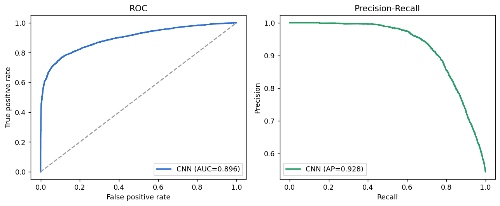
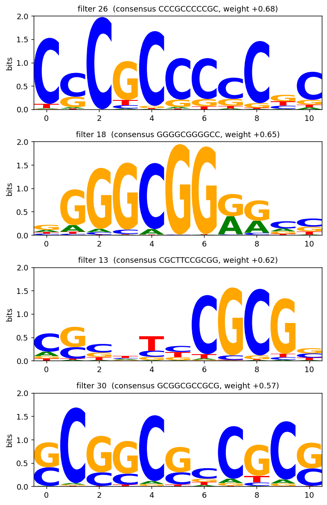
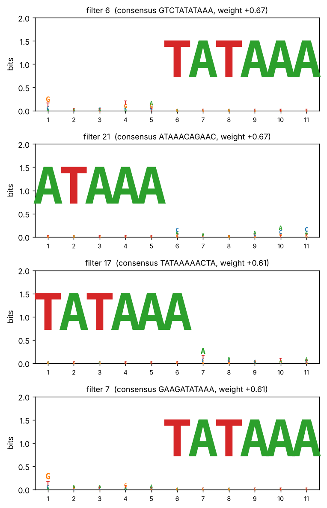

# Reading DNA with a CNN: finding promoters and recovering their motifs

A promoter is the stretch of DNA that marks where a gene starts. This project trains a small 1D
convolutional neural network to read **raw DNA sequence** — just the letters A, C, G, T — and decide
whether a sequence is a promoter. Then it opens the trained network up and shows that its filters have
**taught themselves real promoter motifs**, with no motif ever given as input.

The point is the idea behind DeepBind and the whole family of genomic deep-learning models: a
convolutional filter sliding along DNA *is* a motif scanner, and after training you can read the motif
straight back out of the weights.

## What it finds

Trained on 27,097 real human sequences and tested on a held-out 9,034, the network separates non-TATA
promoters from non-promoter DNA with **ROC-AUC 0.896** and **average precision 0.928** — from a model
with only ~1,500 parameters.



The interesting result is *what* it learned. These are **non-TATA** promoters, so there is no TATA box
to find. Reading the motifs back out of the four most influential filters, the network has instead
discovered the signals that non-TATA promoters actually use — **GC-boxes and CpG-rich elements**:

| Filter | Learned consensus | Known promoter element |
|---|---|---|
| 18 | `GGGGCGGGGCC` | **GC-box / Sp1 binding site** (canonical `GGGGCGGGG`) |
| 26 | `CCCGCCCCCGC` | GC-box, reverse-strand flavour |
| 30 | `GCGGCGCCGCG` | CpG-island / GC-rich core |
| 13 | `CGCTTCCGCGG` | CpG-rich element |



This is the textbook biology: TATA-less promoters lack a TATA box and instead rely on GC-boxes (bound
by the Sp1 transcription factor) and CpG islands. The network was never told any of this — it was
shown only labelled sequence and recovered the right motifs on its own.

## Does the method really recover motifs? A positive control

Before trusting the motifs above, the same pipeline is run on a control dataset where the answer is
known: random sequences in which half carry a planted `TATAAA`. The four most predictive filters each
recover the planted motif cleanly, which is the evidence that the motif-readout procedure works and
isn't inventing patterns.



## How it works

| Step | What happens |
|---|---|
| One-hot encoding | Each base becomes a 4-channel column (A=[1,0,0,0], …); a sequence becomes a 4×251 image |
| Convolution | 32 filters of width 11 slide along the sequence — each is a learnable motif detector |
| Global max-pool | Keeps each filter's strongest hit: *does this motif appear anywhere?* |
| Linear layer | Weighs the 32 detectors into a single promoter score |
| Motif read-out | For each filter, the sequence windows that activate it most are stacked into a PWM and drawn as a sequence logo |

The model is kept deliberately tiny and single-layer precisely so the filters stay readable — the
goal is interpretable biology, not the last decimal of accuracy.

## Data

The **`human_nontata_promoters`** benchmark from
[genomic-benchmarks](https://github.com/ML-Bioinfo-CEITEC/genomic_benchmarks): 36,131 human genomic
windows of 251bp, labelled promoter / non-promoter. The notebook loads the sequences from a public
Hugging Face mirror (it deliberately avoids the original package loader, which depends on the
deprecated `torchtext` and breaks on current PyTorch), and falls back to the synthetic control data if
the download is unavailable, so it always runs end to end.

## How to run

Open `notebooks/dna_promoter_cnn.ipynb` in Google Colab, choose a GPU runtime
(Runtime → Change runtime type → T4 GPU), and Run all (2–4 minutes). It downloads its own data, trains,
evaluates, recovers the motifs, and saves `results_dna.zip`. To run locally instead:

```bash
pip install -r requirements.txt
```

## Repository layout

```
notebooks/   the analysis notebook
results/     metrics, test-set predictions, learned PWMs
figures/     performance and motif figures, plus the positive control
```

## What this project demonstrates

- Building and training a convolutional neural network on raw genomic sequence in PyTorch.
- One-hot encoding of DNA and the view of a convolution as a motif scanner.
- **Interpreting a trained network**: recovering position weight matrices from filters and reading them
  as sequence logos.
- Validating an interpretability method with a positive control before trusting it on real data.
- Connecting the learned features back to known biology (GC-box / Sp1, CpG islands).

## Limitations

- A single convolutional layer captures short motifs but not their spacing or long-range grammar; a
  deeper model would score higher at the cost of interpretability.
- The negatives are length-matched genomic DNA, so the task is promoter-vs-background, not
  promoter-vs-other-regulatory-element.
- Recovered motifs are the patterns the filters respond to; matching them to specific transcription
  factors by eye is suggestive, not a formal motif-database match.

## Data and tools

- Grešová K. *et al.* Genomic benchmarks: a collection of datasets for genomic sequence classification.
  *BMC Genomic Data* 24, 25 (2023).
- PyTorch for the model; scikit-learn for metrics; logomaker for sequence logos.

## Author

**Hafsa Fathima Khajamainudeen**
M.Sc. Bioinformatics & Data Science, Sathyabama Institute of Science and Technology
[Google Scholar](https://scholar.google.com/citations?hl=en&user=Iz5aXRUAAAAJ) · hafsafathima2004@gmail.com

*Code developed with the assistance of an AI coding tool; the analysis design, interpretation and conclusions are the author's own.*
